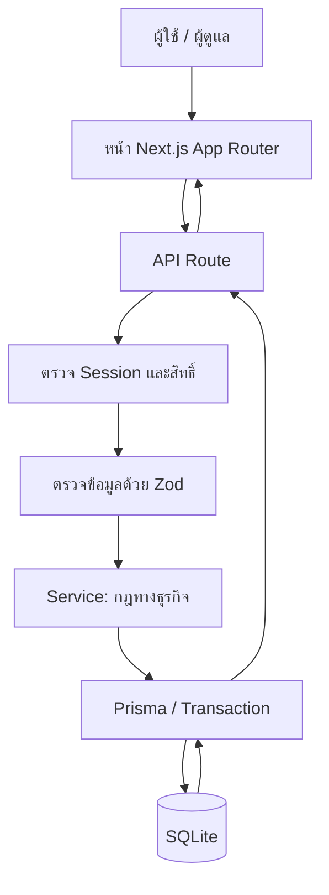

# ระบบยืม-คืนอุปกรณ์ (Equipment Borrowing System)

## 1. ภาพรวมโครงการ

เอกสารนี้เป็นคู่มือแนะนำโครงการ ตั้งแต่แนวคิดและเทคโนโลยี การติดตั้งและตั้งค่า การใช้งานตามบทบาท การเรียก API ไปจนถึงการทดสอบและการอธิบายโค้ด เหมาะสำหรับใช้ทบทวนก่อนสาธิตระบบหรือประกอบการนำเสนอในชั้นเรียน

เว็บแอปสำหรับจัดการการยืมและคืนอุปกรณ์ เช่น คอมพิวเตอร์ โปรเจกเตอร์ และอุปกรณ์สำนักงาน ผู้ใช้ทั่วไปสามารถดูรายการอุปกรณ์และส่งคำขอยืม ส่วนผู้ดูแลระบบสามารถจัดการอุปกรณ์ หมวดหมู่ บัญชีผู้ใช้ และอนุมัติ/จ่าย/รับคืนอุปกรณ์ได้

โครงการใช้ Next.js App Router สำหรับหน้าเว็บและ API, TypeScript สำหรับกำหนดชนิดข้อมูล, Prisma สำหรับเชื่อมฐานข้อมูล SQLite, Auth.js สำหรับการเข้าสู่ระบบ และ Zod สำหรับตรวจสอบข้อมูลก่อนนำไปใช้งาน

## 2. ที่มาและปัญหาที่ต้องการแก้ไข

การยืมอุปกรณ์ที่จดบันทึกแยกกันอาจทำให้ค้นหาประวัติยาก มองไม่เห็นจำนวนคงเหลือที่ตรงกัน และตรวจสอบผู้รับผิดชอบหรือสถานะคำขอได้ไม่สะดวก ระบบนี้รวมข้อมูลอุปกรณ์ คำขอยืม สถานะ และประวัติการดำเนินการไว้ในฐานข้อมูลเดียว

## 3. วัตถุประสงค์

ระบบนี้มุ่งให้การยืม-คืนตรวจสอบได้จากข้อมูลชุดเดียว ลดความสับสนในการติดตามสถานะ และช่วยให้ผู้ดูแลตรวจสอบจำนวนอุปกรณ์พร้อมใช้ได้สะดวก วัตถุประสงค์หลักมีดังนี้

- รวมข้อมูลอุปกรณ์และหมวดหมู่ไว้ในระบบเดียว
- ให้ผู้ใช้ส่งคำขอยืมและติดตามสถานะของตนเองได้
- ให้ผู้ดูแลอนุมัติ ปฏิเสธ จ่ายอุปกรณ์ และบันทึกการคืน
- ควบคุมจำนวนพร้อมใช้และจำนวนซ่อมบำรุง
- แยกสิทธิ์ ADMIN กับ USER และเก็บประวัติการดำเนินการที่สำคัญ
- ตรวจสอบข้อมูลจากฝั่งเซิร์ฟเวอร์ก่อนบันทึกลงฐานข้อมูล

## 4. ความสามารถหลักที่พบในโค้ด

- เข้าสู่ระบบด้วยอีเมล/รหัสผ่าน
- สมัครสมาชิกด้วยตนเองสำหรับอีเมลที่ไม่ใช่โดเมน KKUMail
- เข้าสู่ระบบด้วย Google สำหรับ KKUMail เมื่อกำหนด OAuth credentials
- เข้าสู่ระบบด้วย GitHub แบบทางเลือก เฉพาะอีเมลที่ตรงกับบัญชีในฐานข้อมูลอยู่แล้ว
- แยกหน้าและสิทธิ์ของ ADMIN และ USER
- จัดการอุปกรณ์และหมวดหมู่ รวมถึงค้นหา กรอง และแบ่งหน้า
- ส่งคำขอยืมหลายรายการในคำขอเดียว และกำหนดวันคืนไม่เกิน 30 วัน
- เปลี่ยนสถานะคำขอตามลำดับ: `PENDING` → `APPROVED` → `BORROWED` → `RETURNED` (หรือ `REJECTED`/`CANCELLED` ตามกฎ)
- คำนวณสถานะ `OVERDUE` จากรายการที่ยืมอยู่และเลยกำหนดคืน ไม่ได้เก็บเป็นสถานะถาวร
- รองรับการคืนบางส่วนผ่าน API/service และแยกอุปกรณ์เสียไปยังจำนวนซ่อมบำรุง
- ระงับ/เปิดใช้งานบัญชีผู้ใช้ พร้อมเก็บ AuditLog
- มีชุดทดสอบสำหรับกฎสถานะ การเกินกำหนด และ validation

> ข้อจำกัดที่ยืนยันจากโค้ด: การบันทึกคืนเป็นหน้าที่ ADMIN; ไม่มีหน้าผู้ใช้สำหรับขอคืนอุปกรณ์, ไม่มีหน้าแสดง AuditLog, ไม่มี UI แก้ไขหมวดหมู่ และไม่มีหน้ารายละเอียดอุปกรณ์แยกต่างหาก

## 5. เทคโนโลยีที่ใช้

| เทคโนโลยี | ใช้ทำอะไร |
|---|---|
| Next.js 15 App Router | สร้างหน้าเว็บและ API route ในโครงการเดียวกัน |
| React 19 | สร้าง UI แบบ component |
| TypeScript | ตรวจชนิดข้อมูลและช่วยลดข้อผิดพลาดระหว่างพัฒนา |
| Prisma 6 | นิยาม schema และอ่าน/เขียนฐานข้อมูล |
| SQLite | ฐานข้อมูลสำหรับการพัฒนาในเครื่อง |
| Auth.js v5 beta | จัดการการเข้าสู่ระบบและ session แบบ JWT |
| bcryptjs | hash รหัสผ่านก่อนบันทึกและตรวจสอบตอนเข้าสู่ระบบ |
| Zod | ตรวจสอบข้อมูล request และ query |
| Tailwind CSS 4 | จัดรูปแบบหน้าจอ |
| Vitest | รันทดสอบ unit tests |

## 6. สิ่งที่ต้องมี

- Node.js เวอร์ชันที่รองรับ Next.js 15 (แนะนำ Node.js 20 LTS หรือใหม่กว่า)
- npm
- Git (ไม่จำเป็นถ้าดาวน์โหลดไฟล์ ZIP)
- การเชื่อมต่ออินเทอร์เน็ตครั้งแรกเพื่อดาวน์โหลด dependencies

## 7. โครงสร้างโฟลเดอร์สำคัญ

```text
eb/
├── app/
│   ├── admin/                 # หน้าสำหรับผู้ดูแลระบบ
│   ├── user/                  # หน้าสำหรับผู้ใช้ทั่วไป
│   ├── api/                   # API endpoints
│   ├── login/                 # หน้าเข้าสู่ระบบ
│   ├── register/              # หน้าสมัครสมาชิก
│   ├── globals.css            # สไตล์ส่วนกลาง
│   ├── layout.tsx             # layout หลักและ metadata
│   └── page.tsx               # หน้าเริ่มต้น/เปลี่ยนเส้นทางตามสิทธิ์
├── components/                # React components ที่ใช้ซ้ำ
├── lib/
│   ├── services/              # กฎการทำงานของอุปกรณ์ ผู้ใช้ และการยืม
│   ├── api.ts                 # รูปแบบ response และจัดการ error ของ API
│   ├── guard.ts               # ตรวจ session และสิทธิ์
│   ├── validation.ts          # Zod schemas
│   ├── rules.ts               # กฎสถานะและ overdue
│   ├── prisma.ts              # Prisma client
│   └── rate-limit.ts          # จำกัดความถี่แบบ in-memory
├── prisma/
│   ├── schema.prisma          # แบบจำลองฐานข้อมูล
│   ├── migrations/            # migration SQL ที่มีอยู่
│   └── seed.ts                # สร้าง ADMIN/หมวดหมู่ และข้อมูลตัวอย่างแบบเลือกเปิด
├── tests/rules.test.ts        # unit tests ของกฎและ validation
├── auth.ts                    # การตั้งค่า Auth.js
├── package.json               # dependencies และคำสั่ง npm
├── .env.example               # ตัวอย่างค่าตั้งค่า (ไม่มีข้อมูลลับจริง)
├── vitest.config.ts           # ตั้งค่า Vitest
└── README.md
```

## 8. สถาปัตยกรรมและลำดับการทำงาน

หน้า React เรียก API route; API ตรวจ session/สิทธิ์และตรวจข้อมูลด้วย Zod ก่อนส่งต่อไปยัง service; service ใช้ Prisma อ่านหรือแก้ข้อมูลใน SQLite แล้ว API ส่ง JSON กลับหน้าเว็บ



การเปลี่ยนสถานะและการปรับสต็อกที่สำคัญใช้ transaction เพื่อให้การอัปเดตหลายส่วนสำเร็จหรือย้อนกลับไปพร้อมกันเมื่อเกิดข้อผิดพลาด

## 9. ติดตั้งและตั้งค่า

### ขั้นตอนที่ 1: เปิดโฟลเดอร์โครงการ

เปิด Terminal ที่โฟลเดอร์ซึ่งมี `package.json`

### ขั้นตอนที่ 2: ติดตั้ง dependencies

```bash
npm install
```

คำสั่งนี้ติดตั้ง library ตาม `package-lock.json` และรัน `postinstall` ซึ่งเรียก `prisma generate`

### ขั้นตอนที่ 3: สร้างไฟล์ `.env`

คัดลอก `.env.example` เป็น `.env` แล้วแก้ค่า placeholder ให้เหมาะสม

Windows PowerShell:

```powershell
Copy-Item .env.example .env
```

macOS/Linux:

```bash
cp .env.example .env
```

ตั้งค่าพื้นฐานอย่างน้อยดังนี้:

```dotenv
DATABASE_URL="file:./dev.db"
AUTH_SECRET="ใส่ค่าสุ่มที่ยาวและคาดเดายาก"
ADMIN_EMAIL="admin@example.com"
ADMIN_PASSWORD="เปลี่ยนเป็นรหัสผ่านที่ปลอดภัย"
SEED_SAMPLE="false"
SEED_USER_PASSWORD=""
AUTH_GOOGLE_ID=""
AUTH_GOOGLE_SECRET=""
KKU_EMAIL_DOMAIN="kkumail.com"
AUTH_GITHUB_ID=""
AUTH_GITHUB_SECRET=""
```

สร้างค่า `AUTH_SECRET` ได้ด้วยคำสั่ง:

```bash
npx auth secret
```

นำค่าที่ได้ไปใส่ใน `.env` อย่า commit `.env` หรือแชร์ค่าจริงให้ผู้อื่น

### ขั้นตอนที่ 4: สร้างฐานข้อมูล

โครงการมี migration เริ่มต้นที่ `prisma/migrations/20261017195343_init/migration.sql` ให้รัน:

```bash
npx prisma migrate deploy
```

คำสั่งนี้ใช้ migration ที่มีอยู่เพื่อสร้าง/ปรับโครงสร้างฐานข้อมูลตามลำดับ ไม่ได้สร้าง migration ใหม่

ระหว่างพัฒนา สามารถใช้ `npm run db:migrate -- --name ชื่อการเปลี่ยนแปลง` เพื่อสร้าง migration ใหม่เมื่อมีการแก้ `schema.prisma` (ตรวจสอบผลก่อนนำไปใช้กับข้อมูลจริง)

### ขั้นตอนที่ 5: สร้างบัญชีผู้ดูแลและข้อมูลตั้งต้น

```bash
npm run db:seed
```

สคริปต์จะสร้าง ADMIN จาก `ADMIN_EMAIL` และ `ADMIN_PASSWORD` และสร้างหมวดหมู่เริ่มต้น หากต้องการข้อมูลตัวอย่างเพื่อสาธิต ให้ตั้ง `SEED_SAMPLE="true"` และเลือกกำหนด `SEED_USER_PASSWORD` ที่มีอย่างน้อย 8 ตัวอักษรในฐานข้อมูลพัฒนาเท่านั้น จากนั้นรัน seed อีกครั้ง

> ระวัง: ห้ามเปิด `SEED_SAMPLE=true` ใน production และอย่าใช้รหัสผ่านตัวอย่างในระบบจริง

## 10. วิธีรันระบบ

โหมดพัฒนา:

```bash
npm run dev
```

เปิด `http://localhost:3000`

สร้าง production build และรัน:

```bash
npm run build
npm run start
```

## 11. วิธีใช้งาน

หัวข้อนี้อธิบายลำดับการใช้งานหลักของแต่ละบทบาท ผู้ใช้ควรเข้าสู่ระบบด้วยบัญชีของตนเอง และดำเนินการตามสถานะที่ระบบอนุญาต หากเมนูบางรายการไม่ปรากฏ ให้ตรวจสอบสิทธิ์ของบัญชีและการตั้งค่าระบบ

### ผู้ใช้ทั่วไป (USER)

1. เปิด `/register` เพื่อสมัครสมาชิกด้วยอีเมลที่ไม่ใช่โดเมน KKUMail หรือเปิด `/login` เพื่อเข้าสู่ระบบ
2. หากตั้งค่า Google OAuth ไว้ ผู้ใช้ KKUMail สามารถเลือกเข้าสู่ระบบด้วย Google ได้
3. ไปที่หน้าอุปกรณ์เพื่อค้นหา/กรองรายการ
4. สร้างคำขอยืม เลือกอุปกรณ์ จำนวน วัตถุประสงค์ และวันคืน
5. ดูสถานะและรายละเอียดคำขอของตนเอง
6. แก้ไข/ยกเลิกคำขอได้ตามสถานะที่ระบบอนุญาต

### ผู้ดูแลระบบ (ADMIN)

1. เข้าสู่ระบบด้วยบัญชีที่สร้างผ่าน seed
2. ไปยัง dashboard เพื่อดูข้อมูลสรุป
3. จัดการอุปกรณ์ หมวดหมู่ และบัญชีผู้ใช้
4. ตรวจคำขอแล้วอนุมัติหรือปฏิเสธ
5. เมื่อจ่ายอุปกรณ์จริง ให้ใช้การดำเนินการ `issue` เพื่อปรับสต็อก
6. เมื่อรับคืน ให้บันทึกจำนวนและสภาพอุปกรณ์

## 12. ฐานข้อมูล

ฐานข้อมูลหลักกำหนดไว้ใน `prisma/schema.prisma`:

- `User`: บัญชีผู้ใช้, role, สถานะบัญชี
- `Category`: หมวดหมู่อุปกรณ์
- `Equipment`: ข้อมูลอุปกรณ์และจำนวนรวม/พร้อมใช้/ซ่อม
- `Borrowing`: ข้อมูลคำขอยืม
- `BorrowingItem`: อุปกรณ์และจำนวนในแต่ละคำขอ รวมถึงจำนวนจ่าย/คืน
- `BorrowingEvent`: ประวัติการเปลี่ยนสถานะ
- `AuditLog`: บันทึกการกระทำสำคัญ

คำสั่งฐานข้อมูลที่ใช้บ่อย:

```bash
npx prisma validate       # ตรวจ schema
npx prisma generate       # สร้าง Prisma Client จาก schema
npx prisma migrate deploy # ใช้ migration ที่มีอยู่
npm run db:seed            # สร้างข้อมูลเริ่มต้น
```

## 13. API endpoints ที่สำคัญ

API เป็นช่องทางให้หน้าเว็บติดต่อกับเซิร์ฟเวอร์ โดยใช้ HTTP method ตามวัตถุประสงค์ เช่น `GET` สำหรับอ่านข้อมูล, `POST` สำหรับสร้างหรือสั่งดำเนินการ, `PUT` สำหรับแก้ไขข้อมูล และ `DELETE` สำหรับปิด/ลบรายการตามกติกาของ endpoint แต่ละตัว ต้องตรวจสิทธิ์และข้อมูลที่ส่งเข้ามาก่อนเปลี่ยนแปลงฐานข้อมูล

API ใช้ JSON โดยผลสำเร็จมีรูปแบบ `{ "success": true, "data": ... }` และข้อผิดพลาดมีรูปแบบ `{ "success": false, "error": { "code": "...", "message": "...", "fields": ... } }`

| Method | Endpoint | สิทธิ์/การใช้งาน |
|---|---|---|
| `GET` | `/api/equipment` | ดู/ค้นหาอุปกรณ์และแบ่งหน้า |
| `GET` | `/api/equipment/:id` | ดูอุปกรณ์หนึ่งรายการ |
| `POST` | `/api/equipment` | ADMIN เพิ่มอุปกรณ์ |
| `PUT` / `DELETE` | `/api/equipment/:id` | ADMIN แก้ไข/ปิดรายการอุปกรณ์ (soft delete) |
| `GET` / `POST` | `/api/categories` | ดูหมวดหมู่ / ADMIN เพิ่มหมวดหมู่ |
| `GET` | `/api/borrowings` | ดูรายการตามสิทธิ์และตัวกรอง |
| `POST` | `/api/borrowings` | ส่งคำขอยืม |
| `GET` | `/api/borrowings/my` | ดูประวัติคำขอของตนเอง |
| `GET` / `PUT` / `DELETE` | `/api/borrowings/:id` | ดู/แก้คำขอที่ยังแก้ได้/ยกเลิก |
| `POST` | `/api/borrowings/:id/approve` | ADMIN อนุมัติ |
| `POST` | `/api/borrowings/:id/reject` | ADMIN ปฏิเสธ |
| `POST` | `/api/borrowings/:id/issue` | ADMIN จ่ายอุปกรณ์และตัดสต็อก |
| `POST` | `/api/borrowings/:id/return` | ADMIN บันทึกการคืน |
| `POST` | `/api/borrowings/:id/cancel` | เจ้าของรายการหรือ ADMIN ยกเลิกตามสถานะ |
| `GET` / `POST` | `/api/users` | ADMIN ดู/สร้างบัญชี |
| `GET` / `PUT` | `/api/users/:id` | ADMIN ดู/แก้บัญชี |
| `POST` | `/api/users/:id/suspend` | ADMIN ระงับบัญชี |
| `POST` | `/api/users/:id/reactivate` | ADMIN เปิดบัญชีที่ถูกระงับ |
| `PATCH` | `/api/profile` | ผู้ใช้แก้ชื่อโปรไฟล์ตนเอง |
| `POST` | `/api/register` | สมัครสมาชิกแบบ USER |

ตัวอย่างส่งคำขอยืม (ตัวอย่างโครงสร้างข้อมูล ไม่ใช่บัญชีจริง):

```json
{
  "items": [{ "equipmentId": "รหัสอุปกรณ์จากฐานข้อมูล", "quantity": 1 }],
  "expectedReturnDate": "2030-01-20T10:00:00.000Z",
  "purpose": "ใช้ในการเรียน",
  "notes": "รายละเอียดเพิ่มเติม (ไม่บังคับ)"
}
```

## 14. การเข้าสู่ระบบ OAuth (ทางเลือก)

- Google: ตั้ง `AUTH_GOOGLE_ID` และ `AUTH_GOOGLE_SECRET` พร้อมลงทะเบียน callback URL `http://localhost:3000/api/auth/callback/google` ใน Google Cloud Console ระบบตรวจอีเมลที่ยืนยันแล้วและโดเมน `KKU_EMAIL_DOMAIN`/`KKU_DOMAIN` ตามโค้ด
- GitHub: ตั้ง `AUTH_GITHUB_ID` และ `AUTH_GITHUB_SECRET` พร้อม callback URL `http://localhost:3000/api/auth/callback/github` ระบบอนุญาตเฉพาะอีเมลที่ตรงกับบัญชีเดิมในฐานข้อมูล
- หากไม่ตั้ง credentials ปุ่ม/provider ที่เกี่ยวข้องจะไม่เปิดใช้งาน
- ตรวจค่าคงที่โดเมนใน `lib/domains.ts` และ `auth.ts` ก่อนนำไปใช้จริง เพราะค่าโดเมนที่โค้ดตรวจต้องตรงกับโดเมนบัญชีของสถาบัน

## 15. ทดสอบและตรวจคุณภาพโค้ด

ก่อนนำเสนอหรือส่งมอบงาน ควรรันคำสั่งตรวจสอบในสภาพแวดล้อมเดียวกับที่ใช้พัฒนา แล้วบันทึกผลจริง เช่น ผ่าน/ไม่ผ่านและข้อความผิดพลาดที่พบ ไม่ควรระบุว่าการทดสอบผ่านหากยังไม่ได้รันคำสั่ง

```bash
npm test
npm run typecheck
npm run lint
npx prisma validate
npm run build
```

- `npm test`: รัน Vitest
- `npm run typecheck`: ตรวจชนิดข้อมูล TypeScript
- `npm run lint`: เรียกคำสั่ง lint ที่กำหนดใน `package.json`
- `npx prisma validate`: ตรวจ schema ของ Prisma
- `npm run build`: สร้าง production build

ยังไม่ได้ยืนยันผลการทดสอบในสภาพแวดล้อมนี้ จึงควรรันคำสั่งข้างต้นในเครื่องของผู้พัฒนาก่อนนำเสนอ

## 16. ปัญหาที่พบบ่อย

- **Prisma เชื่อมฐานข้อมูลไม่ได้:** ตรวจ `DATABASE_URL` และรัน `npx prisma validate` กับ `npx prisma migrate deploy`
- **เข้าสู่ระบบไม่ได้:** ตรวจ `AUTH_SECRET`, อีเมล/รหัสผ่าน และตรวจว่าบัญชีไม่ได้ถูกระงับ
- **ปุ่ม Google/GitHub ไม่แสดง:** ตรวจว่าตั้ง client ID และ secret ครบทั้งคู่ แล้ว restart dev server
- **ไม่มีบัญชี ADMIN:** ตรวจ `ADMIN_EMAIL`/`ADMIN_PASSWORD` ใน `.env` แล้วรัน `npm run db:seed`
- **พอร์ต 3000 ถูกใช้งาน:** ปิดโปรแกรมที่ใช้งานพอร์ต หรือใช้ `npm run dev -- -p 3001`
- **ข้อมูลตัวอย่างไม่ปรากฏ:** ตั้ง `SEED_SAMPLE="true"` ในฐานข้อมูลสำหรับพัฒนาและรัน seed อีกครั้ง

## 17. ข้อจำกัดและสิ่งที่ควรปรับปรุง

- rate limit เก็บในหน่วยความจำ จึงไม่แชร์ข้ามหลาย server instance และรีเซ็ตเมื่อโปรเซสเริ่มใหม่
- ไม่มี integration tests สำหรับ API, ฐานข้อมูล หรือการส่งคำขอพร้อมกัน
- ไม่มี UI ดู AuditLog, เปลี่ยนรหัสผ่าน, export CSV หรือ notification
- การคืนบางส่วนมีอยู่ใน service/API แต่หน้า UI ไม่ได้เปิดขั้นตอนคืนบางส่วนอย่างเต็มรูปแบบ
- ควรตรวจโดเมนอีเมลของ Google Workspace กับผู้ดูแลสถาบันก่อนเปิดใช้จริง
- ควรเพิ่มการทดสอบ end-to-end และการตรวจความปลอดภัยก่อน deploy สู่ production

## 18. ผู้จัดทำ

ข้อมูลผู้จัดทำไม่ได้ระบุไว้ใน source code ที่ตรวจพบ สามารถเพิ่มชื่อและรหัสนักศึกษาในส่วนนี้ก่อนส่งงานได้ โดยไม่ควรใส่ข้อมูลส่วนตัวที่ไม่จำเป็น

## 19. สรุปสำหรับการนำเสนอ

โครงการนี้เป็นระบบยืม-คืนอุปกรณ์ที่แบ่งบทบาท USER และ ADMIN ชัดเจน ใช้ Zod ตรวจข้อมูล ใช้ service รวมกฎทางธุรกิจ และใช้ Prisma transaction ป้องกันการเปลี่ยนสถานะ/จำนวนอุปกรณ์ไม่สอดคล้องกัน จุดที่ควรสาธิตคือการส่งคำขอยืม การอนุมัติ การจ่ายอุปกรณ์ และการบันทึกคืน โดยอธิบายว่า stock จะถูกตัดตอนจ่ายจริง ไม่ใช่ตอนสร้างคำขอ


## 20. ภาพหน้าจอโปรแกรม (Screenshots)

> **วิธีใส่ภาพหน้าจอ:** เปิดระบบในเบราว์เซอร์แล้วจับภาพหน้าจอของแต่ละหน้า จากนั้นนำไฟล์ภาพไปวางไว้ในโฟลเดอร์ `docs/screenshots/` ภายในโปรเจกต์ และตั้งชื่อไฟล์ให้ตรงกับตัวอย่างด้านล่าง หรือแก้ชื่อไฟล์ใน Markdown ให้ตรงกับภาพของคุณ  
>
> หากยังไม่มีภาพ สามารถเว้นส่วนนี้ไว้ก่อน แล้วกลับมาเพิ่มภาพภายหลังได้ ภาพที่แสดงใน README จะช่วยให้ผู้อ่านเห็นหน้าตาและขั้นตอนใช้งานจริงของระบบ

### 20.1 หน้าเข้าสู่ระบบ (Login)

หน้านี้ใช้สำหรับให้ผู้ใช้เข้าสู่ระบบก่อนใช้งาน โดยกรอกอีเมลและรหัสผ่านที่ลงทะเบียนไว้ หากมีการตั้งค่า OAuth ไว้ ระบบอาจแสดงตัวเลือกเข้าสู่ระบบผ่าน Google หรือ GitHub ตามเงื่อนไขที่โครงการกำหนด

**ภาพหน้าจอหน้าเข้าสู่ระบบ**

<!-- เพิ่มภาพหน้าจอ Login ที่นี่: 
 -->


คำอธิบายเพิ่มเติม:  
- ผู้ใช้กรอกอีเมลและรหัสผ่านในช่องที่กำหนด
- ระบบตรวจสอบข้อมูลเข้าสู่ระบบและสถานะบัญชีก่อนอนุญาตให้ใช้งาน
- หากข้อมูลไม่ถูกต้อง ควรแสดงข้อความแจ้งเตือนเพื่อให้ผู้ใช้ตรวจสอบอีกครั้ง

### 20.2 หน้าสมัครสมาชิก (Register)

หน้าสมัครสมาชิกใช้สำหรับสร้างบัญชีผู้ใช้ใหม่ โดยระบบจะตรวจสอบข้อมูลที่กรอกก่อนบันทึก และบัญชีที่สมัครด้วยตนเองจะได้รับสิทธิ์ USER ตามกฎของระบบ

**ภาพหน้าจอหน้าสมัครสมาชิก**

<!-- เพิ่มภาพหน้าจอ Register ที่นี่: docs/screenshots/02-register.png -->


คำอธิบายเพิ่มเติม:  
- กรอกข้อมูลตามช่องที่หน้าเว็บกำหนด
- ตรวจสอบความถูกต้องของอีเมลและรหัสผ่านก่อนส่งข้อมูล
- ระบบตรวจสอบข้อมูลซ้ำและบันทึกบัญชีเมื่อผ่านเงื่อนไข

### 20.3 หน้า Dashboard ผู้ดูแลระบบ (Admin Dashboard)

หน้า Dashboard เป็นหน้าสรุปข้อมูลสำหรับผู้ดูแลระบบ ใช้เป็นจุดเริ่มต้นในการเข้าถึงส่วนจัดการอุปกรณ์ คำขอยืม และบัญชีผู้ใช้ โดยเมนูที่เข้าถึงได้ขึ้นอยู่กับสิทธิ์ ADMIN

**ภาพหน้าจอ Admin Dashboard**

<!-- เพิ่มภาพหน้าจอ Admin Dashboard ที่นี่: docs/screenshots/03-admin-dashboard.png -->


คำอธิบายเพิ่มเติม:  
- ใช้ดูข้อมูลภาพรวมที่ระบบแสดง
- ใช้เข้าถึงเมนูจัดการข้อมูลตามสิทธิ์ผู้ดูแล
- ผู้ใช้ทั่วไปไม่ควรเข้าถึงหน้าหรือ API ที่สงวนไว้สำหรับ ADMIN

### 20.4 หน้ารายการอุปกรณ์ (Equipment List)

หน้ารายการอุปกรณ์ใช้แสดงข้อมูลอุปกรณ์ที่มีในระบบ ผู้ใช้สามารถค้นหาหรือกรองรายการตามตัวเลือกที่หน้าเว็บรองรับ ส่วนผู้ดูแลสามารถจัดการข้อมูลอุปกรณ์ตามสิทธิ์ที่กำหนด

**ภาพหน้าจอรายการอุปกรณ์**

<!-- เพิ่มภาพหน้าจอ Equipment List ที่นี่: docs/screenshots/04-equipment-list.png -->


คำอธิบายเพิ่มเติม:  
- แสดงข้อมูลอุปกรณ์และจำนวนที่พร้อมใช้งานตามข้อมูลในฐานข้อมูล
- การค้นหาและตัวกรองช่วยให้ค้นหารายการที่ต้องการได้สะดวกขึ้น
- ผู้ดูแลระบบสามารถเพิ่ม แก้ไข หรือปิดรายการอุปกรณ์ได้ตามสิทธิ์

### 20.5 หน้าเพิ่มหรือแก้ไขอุปกรณ์ (Equipment Form)

หน้าฟอร์มนี้ใช้กรอกข้อมูลอุปกรณ์ เช่น ชื่ออุปกรณ์ หมวดหมู่ และจำนวนตามช่องที่ระบบกำหนด ระบบควรตรวจสอบข้อมูลก่อนบันทึกเพื่อป้องกันข้อมูลที่ไม่ครบถ้วนหรือไม่ถูกต้อง

**ภาพหน้าจอฟอร์มอุปกรณ์**

<!-- เพิ่มภาพหน้าจอ Equipment Form ที่นี่: docs/screenshots/05-equipment-form.png -->


คำอธิบายเพิ่มเติม:  
- กรอกข้อมูลอุปกรณ์ให้ครบถ้วนตามฟอร์ม
- ตรวจสอบค่าที่กรอกก่อนกดบันทึก
- การแก้ไขหรือปิดรายการอุปกรณ์เป็นหน้าที่ของผู้ดูแลระบบ

### 20.6 หน้าสร้างคำขอยืมอุปกรณ์ (New Borrowing)

ผู้ใช้เลือกอุปกรณ์และจำนวนที่ต้องการยืม พร้อมระบุวัตถุประสงค์และวันที่คาดว่าจะคืน ระบบตรวจสอบจำนวนที่ขอและวันที่คืนก่อนสร้างคำขอ โดยคำขอใหม่จะเข้าสู่สถานะรออนุมัติ (`PENDING`)

**ภาพหน้าจอสร้างคำขอยืม**

<!-- เพิ่มภาพหน้าจอ New Borrowing ที่นี่: docs/screenshots/06-new-borrowing.png -->


คำอธิบายเพิ่มเติม:  
- เลือกอุปกรณ์และระบุจำนวนที่ต้องการ
- ระบุวันคืนตามเงื่อนไขของระบบ ซึ่งกำหนดไม่เกิน 30 วัน
- การสร้างคำขอยังไม่ตัดจำนวนอุปกรณ์คงเหลือ เพราะต้องรอการอนุมัติและจ่ายอุปกรณ์จริง

### 20.7 หน้าประวัติและสถานะคำขอยืม (Borrowing History)

หน้านี้ช่วยให้ผู้ใช้ตรวจสอบคำขอยืมของตนเองและติดตามสถานะปัจจุบันได้ โดยสถานะอาจเป็นรออนุมัติ อนุมัติแล้ว ยืมอยู่ คืนแล้ว ปฏิเสธ หรือยกเลิก ทั้งนี้ขึ้นอยู่กับขั้นตอนที่เกิดขึ้นจริง

**ภาพหน้าจอประวัติคำขอยืม**

<!-- เพิ่มภาพหน้าจอ Borrowing History ที่นี่: docs/screenshots/07-borrowing-history.png -->


คำอธิบายเพิ่มเติม:  
- ตรวจสอบรายการคำขอและสถานะของแต่ละรายการ
- ผู้ใช้สามารถแก้ไขหรือยกเลิกคำขอได้เฉพาะสถานะที่ระบบอนุญาต
- สถานะเกินกำหนด (`OVERDUE`) คำนวณจากรายการที่ยังยืมอยู่และผ่านวันคืนที่กำหนด

### 20.8 หน้าจัดการคำขอยืมสำหรับผู้ดูแล (Borrowing Management)

ผู้ดูแลระบบใช้ตรวจสอบคำขอและดำเนินการตามลำดับการทำงาน เช่น อนุมัติหรือปฏิเสธคำขอ และบันทึกการจ่ายอุปกรณ์จริง การดำเนินการแต่ละประเภทจะเปลี่ยนสถานะตามกฎของระบบ

**ภาพหน้าจอจัดการคำขอยืม**

<!-- เพิ่มภาพหน้าจอ Borrowing Management ที่นี่: docs/screenshots/08-borrowing-management.png -->


คำอธิบายเพิ่มเติม:  
- ตรวจสอบรายละเอียดคำขอก่อนดำเนินการ
- อนุมัติหรือปฏิเสธคำขอตามความเหมาะสม
- เมื่อจ่ายอุปกรณ์จริง ให้บันทึกการจ่ายเพื่อให้ระบบปรับจำนวนพร้อมใช้

### 20.9 หน้าบันทึกการคืนอุปกรณ์ (Return Equipment)

การรับคืนอุปกรณ์เป็นหน้าที่ของผู้ดูแลระบบ ผู้ดูแลบันทึกจำนวนที่คืนและสภาพอุปกรณ์ หากอุปกรณ์อยู่ในสภาพดี ระบบจะเพิ่มจำนวนพร้อมใช้ แต่หากชำรุดจะนำจำนวนไปอยู่ในส่วนซ่อมบำรุงแทน

**ภาพหน้าจอบันทึกการคืนอุปกรณ์**

<!-- เพิ่มภาพหน้าจอ Return Equipment ที่นี่: docs/screenshots/09-return-equipment.png -->


คำอธิบายเพิ่มเติม:  
- บันทึกจำนวนอุปกรณ์ที่ได้รับคืนจริง
- ระบุสภาพอุปกรณ์ตามตัวเลือกที่ระบบรองรับ
- ตรวจสอบจำนวนคงเหลือหลังบันทึก เพื่อให้ตรงกับสภาพการใช้งานจริง

### 20.10 หน้าจัดการบัญชีผู้ใช้ (User Management)

ผู้ดูแลระบบสามารถตรวจสอบบัญชีผู้ใช้และดำเนินการตามสิทธิ์ที่ระบบกำหนด เช่น ระงับหรือเปิดใช้งานบัญชี การเปลี่ยนสถานะบัญชีจะถูกบันทึกเป็นประวัติการดำเนินการสำคัญในระบบ

**ภาพหน้าจอจัดการบัญชีผู้ใช้**

<!-- เพิ่มภาพหน้าจอ User Management ที่นี่: docs/screenshots/10-user-management.png -->


คำอธิบายเพิ่มเติม:  
- ตรวจสอบข้อมูลบัญชีผู้ใช้ที่ระบบอนุญาตให้แสดง
- ระงับบัญชีที่ไม่ควรใช้งาน หรือเปิดใช้งานอีกครั้งตามความเหมาะสม
- การจัดการบัญชีผู้ใช้เป็นสิทธิ์ของ ADMIN เท่านั้น

> **หมายเหตุ:** ภาพตัวอย่างข้างต้นเป็นตำแหน่งสำหรับใส่ภาพหน้าจอของระบบจริง ไม่ใช่ภาพที่สร้างขึ้นให้อัตโนมัติ หากชื่อหน้า เมนู หรือองค์ประกอบในโปรแกรมของคุณแตกต่างจากคำอธิบาย ให้แก้คำอธิบายให้ตรงกับหน้าจอจริงก่อนส่งงาน

### วิธีเพิ่มภาพหน้าจอให้แสดงใน README

1. สร้างโฟลเดอร์ `docs/screenshots` ที่ระดับเดียวกับไฟล์ `README.md`
2. จับภาพหน้าจอจากโปรแกรมจริง แล้วบันทึกเป็นไฟล์ PNG เช่น `01-login.png`
3. นำไฟล์ภาพไปวางในโฟลเดอร์ `docs/screenshots`
4. ตรวจสอบว่าชื่อไฟล์และนามสกุลตรงกับที่ระบุใน README
5. เปิด README ใน VS Code หรือ GitHub เพื่อตรวจสอบว่าภาพแสดงถูกต้อง

ตัวอย่างโครงสร้างไฟล์:

```text
eb/
├── docs/
│   └── screenshots/
│       ├── 01-login.png
│       ├── 02-register.png
│       ├── 03-admin-dashboard.png
│       ├── 04-equipment-list.png
│       ├── 05-equipment-form.png
│       ├── 06-new-borrowing.png
│       ├── 07-borrowing-history.png
│       ├── 08-borrowing-management.png
│       ├── 09-return-equipment.png
│       └── 10-user-management.png
└── README.md
```


## 21. อธิบายโค้ดแบบละเอียดสำหรับผู้เริ่มต้น

หัวข้อนี้อธิบายว่าโค้ดแต่ละชั้นรับผิดชอบอะไร และเหตุใดจึงแยกหน้าที่กัน ไม่จำเป็นต้องจำทุกบรรทัด แต่ควรเข้าใจเส้นทางข้อมูลตั้งแต่ผู้ใช้กดปุ่มจนข้อมูลถูกบันทึก

### 21.1 แบ่งโค้ดออกเป็น 5 ชั้น

1. **หน้าเว็บ (`app/`)** แสดงข้อมูล รับการกดปุ่ม และเก็บค่าจากฟอร์ม ตัวอย่างเช่นหน้า `app/user/borrowings/new/page.tsx` เป็นหน้าที่ผู้ใช้เริ่มสร้างคำขอยืม
2. **Component (`components/`)** เป็นส่วน UI ที่นำกลับมาใช้ซ้ำ เช่น `NewBorrowingForm.tsx` รับผิดชอบฟอร์ม ส่วน `BorrowingList.tsx` แสดงรายการคำขอ
3. **API Route (`app/api/`)** เป็นจุดรับ HTTP request เช่น `POST /api/borrowings` ใช้สร้างคำขอใหม่ ชั้นนี้ควรตรวจ session และรูปแบบข้อมูลก่อนส่งต่อ
4. **Service (`lib/services/`)** เป็นที่รวมกฎธุรกิจ เช่นตรวจจำนวนคงเหลือ เปลี่ยนสถานะ และปรับสต็อก เพื่อไม่ให้กฎสำคัญกระจัดกระจายอยู่ในหน้าเว็บ
5. **ฐานข้อมูล (`prisma/`)** `schema.prisma` อธิบายข้อมูลและความสัมพันธ์ ส่วน Prisma Client ใช้อ่าน/เขียนข้อมูลจริงใน SQLite

### 21.2 เส้นทางการสร้างคำขอยืมทีละขั้น

1. ผู้ใช้กรอกอุปกรณ์ จำนวน วัตถุประสงค์ และวันคืนในหน้าเว็บ
2. Component ส่งข้อมูลไป `POST /api/borrowings`
3. `app/api/borrowings/route.ts` เรียก `requireUser()` เพื่อยืนยันว่ามีผู้ใช้เข้าสู่ระบบ
4. `parseBody(req, borrowingCreateSchema)` อ่าน JSON และตรวจข้อมูล เช่น ต้องมีอุปกรณ์อย่างน้อยหนึ่งรายการ จำนวนต้องเป็นจำนวนเต็ม และวันคืนต้องอยู่ในช่วงที่กำหนด
5. `createBorrowing()` ใน `lib/services/borrowing.ts` ตรวจอุปกรณ์ซ้ำ ตรวจว่าอุปกรณ์มีอยู่จริง ไม่ถูกปิด และมีจำนวนพร้อมใช้เพียงพอ
6. Service สร้างรหัสคำขอ แล้วบันทึก `Borrowing`, `BorrowingItem` และเหตุการณ์แรก `PENDING`
7. API ส่งข้อมูลกลับเป็น JSON ให้หน้าเว็บแสดงผล

**เหตุผลที่สร้างคำขอแล้วยังไม่ตัดสต็อก:** คำขอยังต้องรอการตรวจสอบ และอาจถูกปฏิเสธหรือยกเลิก การลดสต็อกเกิดตอน `issueBorrowing()` เมื่อ ADMIN จ่ายอุปกรณ์จริง

### 21.3 ทำความเข้าใจ `async`, `await` และ Prisma

- `async function` ระบุว่าฟังก์ชันทำงานแบบ asynchronous และสามารถคืนค่าเป็น Promise ได้
- `await` ใช้รอผลจากงานที่ใช้เวลา เช่น query ฐานข้อมูล ก่อนนำผลไปใช้ในบรรทัดถัดไป
- `findUnique()` ค้นหาด้วยเงื่อนไขที่ระบุว่าไม่ซ้ำ เช่น `id` หรือ `email`
- `findMany()` อ่านหลายแถว โดยอาจมีตัวกรอง การเรียง และการแบ่งหน้า
- `create()` เพิ่มข้อมูลใหม่
- `update()` แก้ข้อมูลหนึ่งรายการและมักเกิดข้อผิดพลาดถ้าไม่พบแถว
- `updateMany()` แก้ข้อมูลที่ตรงเงื่อนไขและคืนค่า `count` ซึ่งโค้ดใช้ตรวจว่ามีรายการถูกเปลี่ยนจริงหรือไม่
- `$transaction()` รวมหลายคำสั่งให้สำเร็จหรือย้อนกลับไปพร้อมกันเมื่อเกิดข้อผิดพลาด

### 21.4 ทำไมต้องใช้ `updateMany()` พร้อมเงื่อนไขสถานะ

ตัวอย่างแนวคิดจากการอนุมัติ: แก้เฉพาะแถวที่มี `id` ตรงกันและ `status` ยังเป็น `PENDING` หากคำขอถูกอนุมัติไปแล้วหรือถูกยกเลิกก่อนหน้า จะไม่มีแถวตรงเงื่อนไขและ `count` จะเป็น `0` วิธีนี้ช่วยป้องกันการเปลี่ยนสถานะจากข้อมูลเก่าหรือการกดดำเนินการซ้ำ

### 21.5 ทำไม `issueBorrowing()` ต้องใช้ transaction

การจ่ายอุปกรณ์มีหลายงานที่ต้องสัมพันธ์กัน:

1. เปลี่ยนสถานะคำขอเป็น `BORROWED`
2. ตรวจและลด `availableQuantity` ของอุปกรณ์แต่ละรายการ
3. บันทึกจำนวนที่จ่ายจริงและสภาพอุปกรณ์ตอนจ่าย
4. เพิ่ม `BorrowingEvent` และ `AuditLog`

ถ้าตัดสต็อกอุปกรณ์รายการที่สองไม่ได้หลังจากรายการแรกถูกตัดแล้ว transaction จะย้อนกลับการเปลี่ยนแปลงทั้งหมด ไม่ปล่อยให้สถานะคำขอและจำนวนคงเหลือไม่ตรงกัน

### 21.6 ทำไมการคืนต้องดูสภาพอุปกรณ์

`returnBorrowing()` ตรวจจำนวนที่คืนว่าไม่เกินจำนวนที่ยังค้าง หากสภาพเป็น `GOOD` จะเพิ่ม `availableQuantity`; หากเป็น `DAMAGED` จะเพิ่ม `maintenanceQuantity` แทน เพราะอุปกรณ์เสียไม่ควรถูกแสดงเป็นของพร้อมให้ยืมทันที ระบบรองรับการคืนบางส่วน และเปลี่ยนคำขอเป็น `RETURNED` เมื่อทุกรายการคืนครบ

### 21.7 ความหมายของ `OVERDUE`

`OVERDUE` เป็นสถานะสำหรับแสดงผลที่คำนวณจากเงื่อนไขสองข้อ: สถานะจริงยังเป็น `BORROWED` และ `expectedReturnDate` น้อยกว่าเวลาปัจจุบัน ฟังก์ชัน `isOverdue()` และ `displayStatus()` ทำให้ไม่ต้องอัปเดตฐานข้อมูลทุกครั้งที่วันเวลาผ่านไป

### 21.8 Authentication กับ Authorization

- **Authentication** ตรวจว่าผู้ใช้เป็นใคร เช่น ตรวจอีเมลและรหัสผ่านใน `auth.ts`
- **Authorization** ตรวจว่าผู้ใช้มีสิทธิ์ทำสิ่งนั้นหรือไม่ เช่น `requireAdmin()` ปฏิเสธ USER ที่พยายามเรียก API สำหรับ ADMIN

การซ่อนปุ่มใน UI ไม่ใช่การรักษาความปลอดภัยที่เพียงพอ เพราะผู้ใช้สามารถเรียก API โดยตรงได้ จึงต้องตรวจสิทธิ์ในฝั่งเซิร์ฟเวอร์ด้วย

### 21.9 Zod schema ช่วยอะไร

schema เช่น `borrowingCreateSchema` เป็นกติกาว่าข้อมูลแบบไหนที่ยอมรับได้ ตัวอย่างเช่นจำนวนต้องเป็นจำนวนเต็มและอย่างน้อย 1, `purpose` ต้องไม่ว่าง และวันคืนต้องเป็นอนาคตไม่เกิน 30 วัน การตรวจข้อมูลช่วยลดข้อมูลผิดรูปแบบก่อนเข้า service แต่ service ยังต้องตรวจข้อมูลจริงในฐานข้อมูล เช่นจำนวนคงเหลือ เพราะสต็อกอาจเปลี่ยนหลังจากหน้าเว็บโหลดข้อมูล

### 21.10 วิธีอ่านโค้ดให้เข้าใจง่าย

เมื่อเปิดฟังก์ชันใด ให้ถามตามลำดับนี้:

1. ฟังก์ชันนี้รับค่าอะไรเข้ามา (พารามิเตอร์)
2. ตรวจสอบอะไรบ้างก่อนทำงาน
3. อ่านหรือแก้ฐานข้อมูลตรงไหน
4. เงื่อนไขใดทำให้เกิด error
5. คืนค่าอะไรให้ผู้เรียก
6. ใครเป็นผู้เรียกฟังก์ชันนี้ (ค้นหาชื่อฟังก์ชันในโครงการ)

วิธีนี้ช่วยให้เข้าใจทั้งหน้าที่ของฟังก์ชันและความสัมพันธ์ระหว่างไฟล์ โดยไม่จำเป็นต้องท่องโค้ดทีละบรรทัด
